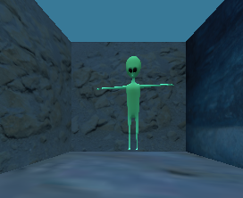
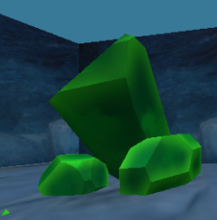
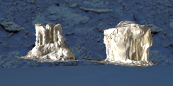
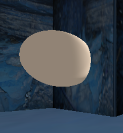
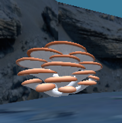
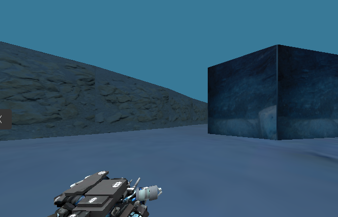

# Perception

Owner: Andrew Than.

## Perception 1: Image dataset

### Method

The aim of Perception 1 was to collect a dataset of artefact images from the rover's onboard RGB camera. Images are saved automatically while the rover explores, so the dataset grows without manual effort.

The camera feed is read from the ROS 2 `camera/image` topic. Each frame received by the image callback is converted to OpenCV format with `CvBridge`. A dataset directory is created at start-up, and a frame is saved every 3 s. The interval avoids near-identical consecutive frames and limits storage use. Each file is named after its timestamp, so the images are unique and in time order. The relevant part of `perception/dataset_collector.py` is shown below.

```python
# Set-up: create the dataset folder and the save interval
self.dataset_directory_ = os.path.expanduser("~/artifact_dataset")
os.makedirs(self.dataset_directory_, exist_ok=True)
self.last_image_save_time_ = 0.0
self.save_interval_ = 3.0  # seconds between saved images

# In image_callback: save one frame every save_interval_ seconds
if current_time - self.last_image_save_time_ > self.save_interval_:
    filename = f"image_{int(current_time)}.png"
    filepath = os.path.join(self.dataset_directory_, filename)
    cv2.imwrite(filepath, image)
    self.last_image_save_time_ = current_time
    self.get_logger().info(f"Saved dataset image: {filepath}")
```

### Results

The collector ran throughout exploration and captured artefacts from a range of distances, orientations and viewpoints without human input. Figure 1 shows one example of each artefact type and a negative example with no artefact.

| Alien | Crystal | Ice cap | Sphere |
|:---:|:---:|:---:|:---:|
|  |  |  |  |

| Mushroom | Stop sign | Nothing (negative) |
|:---:|:---:|:---:|
|  |  |  |

*Figure 1. Example dataset images for each artefact type, captured by the rover camera during exploration.*

Because the images were collected during autonomous exploration, the number of images of each artefact depends on the rover's path. Artefacts that stayed in view for longer contributed more images, so the dataset is imbalanced (Table 1).

*Table 1. Distribution of artefact images collected in 5 minutes of exploration.*

| Artefact type | Images showing it |
|---|---:|
| Alien | 4 |
| Crystal | 17 |
| Ice cap | 23 |
| Sphere | 41 |
| Mushroom | 13 |
| Stop sign | 73 |
| Nothing (negative example) | 1 |
| **Images saved** | **100** |

One image can show several artefacts, so the counts add up to 172 for 100 images.

Spheres and stop signs appeared in the camera's view most often, while the alien was seen least. This reflects the rover's exploration path rather than a deliberate sampling strategy. In total, 100 artefact images were collected with no manual intervention.

### Limitations and improvements

All images are saved to a single directory, and the artefact class of each image is not recorded. The images therefore had to be inspected and sorted by hand before they could be used. The class balance also depends on the navigation path, which leaves some classes with far fewer images than others.

The collection could be improved by labelling images automatically: once the perception system detects an artefact, the frame could be saved into a folder for that class. Metadata such as the artefact distance, rover pose and timestamp could be stored with each image. A more structured exploration strategy, or a cap on images per class, would give a more balanced dataset.

## Perception 2: Artefact detection

## Perception 3: Artefact localisation and display
